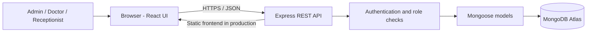
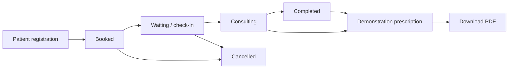
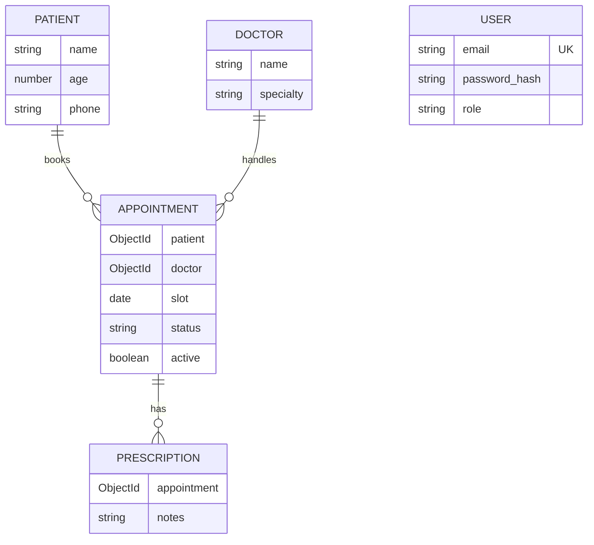

# MediFlow | Smart Clinic Operations Platform

    

A full-stack MERN portfolio project that brings clinic administration, appointment scheduling, patient queues and demonstration prescriptions into one web application.

**[Live application](https://mediflow-v4hx.onrender.com)** | Version 3.0

> Demonstration only. Uses synthetic data. Not intended for clinical use. Access credentials are private and available from the project owner. Free hosting may take a short time to wake up.

## Business problem

Fragmented clinic workflows can make appointment coordination, patient registration and consultation tracking difficult. MediFlow demonstrates a centralized workflow with role-based access and operational visibility.

## Features

| Module | Capabilities |
| --- | --- |
| Dashboard | Patient, doctor and appointment counts; appointment status summaries |
| Patients | Registration, record management and search |
| Doctors | Doctor directory and specialty management |
| Appointments | Future 15-minute slots, calendar, filters and duplicate-slot prevention |
| Live queue | Check-in, appointment-based tokens, call next patient, consultation completion; five-second polling implemented |
| Prescriptions | Doctor-created consultation notes and downloadable demonstration PDFs |
| Authentication | JWT sessions, bcrypt password verification and three roles |
| Security | Login rate limiting, request validation, role checks and console audit events |

## Technology stack

| Layer | Technology |
| --- | --- |
| Frontend | React, Vite, CSS |
| Backend | Node.js, Express.js, REST API |
| Database | MongoDB Atlas, Mongoose |
| Authentication | JSON Web Tokens (JWT), bcryptjs |
| Security middleware | Helmet, express-rate-limit |
| Testing | Node.js assert and Fetch API |
| Version control | Git, GitHub |
| Deployment | Render |

## System architecture



The production Express service serves both the built React frontend and the REST API. Mongoose manages database access. During development, Vite proxies API requests to the local Express server.

## Clinic workflow



## Database design



The user model stores the bcrypt hash in its `password` field (shown conceptually as `password_hash` above). Appointment records reference patients and doctors. Prescription records reference appointments. User roles are clinic-wide; user accounts are not linked to individual doctor records for record-level authorization.

## Role-based access

The following matrix describes intended backend permissions, not a claim of fully passed live authorization tests.

| Action | Admin | Doctor | Receptionist |
| --- | :---: | :---: | :---: |
| View dashboard, patients, doctors, appointments and queue | Yes | Yes | Yes |
| Create or edit patients | Yes | No | Yes |
| Create or edit doctors | Yes | No | No |
| Book appointments | Yes | No | Yes |
| Check in or cancel eligible appointments | Yes | Yes | Yes |
| Start or complete consultation | Yes | Yes | No |
| View prescriptions | Yes | Yes | No |
| Create prescriptions | No | Yes | No |

## REST API

All endpoints below use the `/api` prefix. Except health and login, requests require an Authorization header containing a valid Bearer token.

| Method | Endpoint | Purpose |
| --- | --- | --- |
| GET | `/health` | Service health |
| POST | `/login` | Authenticate and receive JWT |
| GET | `/dashboard` | Operational summary |
| GET / POST | `/patients` | List / create patients |
| PATCH | `/patients/:id` | Update patient |
| GET / POST | `/doctors` | List / create doctors |
| PATCH | `/doctors/:id` | Update doctor |
| GET / POST | `/appointments` | List / book appointments |
| PATCH | `/appointments/:id` | Change appointment status |
| GET | `/queue` | Checked-in waiting and consulting appointments |
| GET / POST | `/prescriptions` | List / create prescriptions |

Write operations are subject to the role restrictions above. Appointment status transitions and active doctor-slot uniqueness are enforced by the backend.

## Project structure

```text
MediFlow/
├── client/
│   ├── src/
│   │   ├── main.jsx
│   │   ├── Dashboard.jsx
│   │   ├── Calendar.jsx
│   │   ├── Queue.jsx
│   │   ├── PrescriptionPDF.js
│   │   └── style.css
│   ├── package.json
│   └── vite.config.js
├── server/
│   ├── index.js
│   ├── seed-demo.mjs
│   ├── security-test.mjs
│   ├── .env.example
│   └── package.json
├── dev.cjs
├── package.json
├── .gitignore
└── README.md
```

## Local installation

Prerequisites: Node.js, npm, Git and a dedicated MongoDB database (local or Atlas).

```powershell
git clone https://github.com/harsha-nm/MediFlow.git
cd MediFlow
Copy-Item server/.env.example server/.env
npm ci --prefix server
npm ci --prefix client
```

Repository access is required if the repository is private. Configure `server/.env` privately:

| Variable | Purpose |
| --- | --- |
| `MONGO_URI` | Dedicated synthetic MongoDB database connection URI |
| `JWT_SECRET` | Unique random signing secret, at least 32 characters |
| `DEMO_SEED` | Set `true` only to initialize synthetic demo accounts |
| `DEMO_PASSWORD` | Private demo password, at least 12 characters, required when seeding |
| `PORT` | Optional local API port; default 4000 |

Use a strong demo password below bcrypt's 72-byte input limit. Existing accounts are not reset by seeding. Disable demo seeding after initialization. Never commit `.env` or credentials.

```powershell
npm run dev
```

Open `http://localhost:5173`. The API runs on port 4000 by default.

Optional synthetic data initialization (only against a dedicated demo database):

```powershell
node server/seed-demo.mjs
```

## Production deployment

Render deploys the application from GitHub with MongoDB Atlas as its database.

| Setting | Value |
| --- | --- |
| Build command | `npm ci --prefix server && npm ci --prefix client && npm run build` |
| Start command | `npm start` |
| Environment | `NODE_ENV=production`, `DEMO_SEED=false` |
| Secrets | `MONGO_URI`, `JWT_SECRET` configured privately in Render |
| Health endpoint | `/api/health` |

Restrict Atlas network access and use least-privilege database credentials. Configure `TRUST_PROXY=1` only after verifying the hosting proxy topology.

## Testing and validation

The cloud demo was seeded with 500 synthetic patients, 15 synthetic doctors, 2,500 appointments and 1,000 prescriptions, in addition to initial records. Subsequent demonstration operations changed the totals.

| Validation | Result |
| --- | --- |
| Live health endpoint | Passed |
| Browser login for all three roles | Passed (manual) |
| Patient registration and search | Passed (manual) |
| Doctor registration and appointment booking | Passed (manual) |
| Calendar date selection | Passed (manual) |
| Queue check-in, call and completion | Passed (manual) |
| Prescription creation and PDF output | Passed (manual) |
| Live automated security tests | 5 of 8 groups passed; 3 role groups unresolved |

The automated suite passed health, unauthenticated access rejection, invalid token rejection, invalid login input rejection and incorrect password rejection. The three role groups failed during live testing with authentication/input errors. Browser login succeeded for all roles, but automated role authorization remains unverified. Do not interpret manual login as proof of all access controls.

To run the automated suite, set `TEST_DEMO_PASSWORD` privately in the shell and optionally set `TEST_BASE_URL` to the deployment URL. Then run:

```powershell
node server/security-test.mjs
```

The script defaults to `http://127.0.0.1:4000`. Remove temporary credential environment variables afterward.

## Application screenshots

Screenshots of the dashboard, calendar, queue and demonstration prescription will be added after review. No real patient data or credentials should appear in screenshots.

## Limitations and future improvements

- Complete live automated authorization testing and improve endpoint-level failure diagnostics.
- Add doctor-to-patient record-level authorization and separate demo credentials.
- Verify proxy-aware rate limiting and enforce a safe bcrypt password byte limit.
- Add persistent audit storage, stronger security headers and session revocation.
- Verify queue polling and calendar navigation independently; add automated browser tests.
- Improve pagination, accessibility and deployment monitoring.
- Free hosting may introduce cold starts; this project has not undergone a comprehensive security audit.

## Author

Harsha N M — MCA student | Full-stack portfolio project

**Disclaimer:** MediFlow is an educational software demonstration, not a production healthcare system or compliance-certified product. Do not store real patient information or publish shared writable demo credentials.
